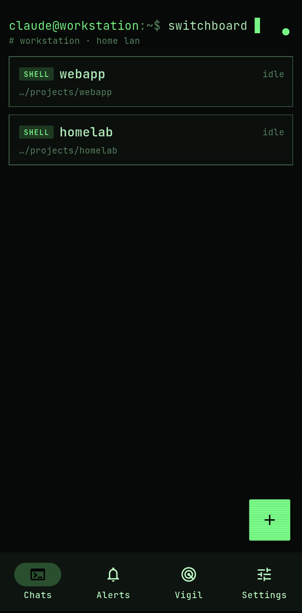
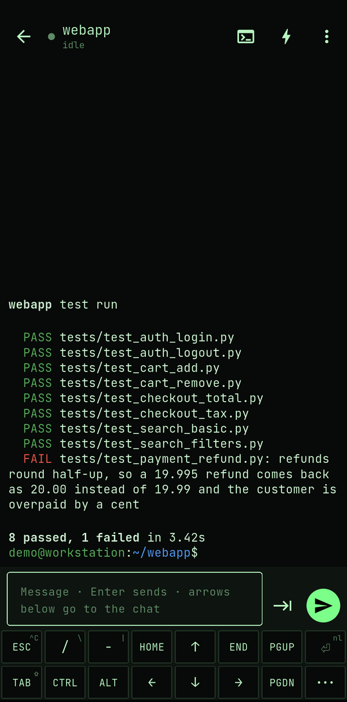

# Switchboard (2.0)

**The app for the [Goblin](https://github.com/levoniust/goblin) network: your AI agent chats on every computer you
own, in one place, on your phone or desktop.** In development, looking for testers.

Goblin runs Claude Code, Pi, Kilo Code or a plain shell on each of your computers and joins them into one network.
Switchboard is its app (Flutter: Android, Windows, Linux). The two talk only through Goblin's versioned client API
([PROTOCOL.md](https://github.com/levoniust/goblin/blob/main/docs/PROTOCOL.md)); the app checks each computer's API
version and features, so the app and the computers can be upgraded separately.

> Switchboard 1.x (a phone app plus a Python bridge per machine) is retired; its code stays at
> [levoniust/switchboard](https://github.com/levoniust/switchboard). 2.0 is a new app for Goblin and shares no back end
> with it.

<p>
  
  
</p>

## What it does
- **Every computer, one list.** Chats are grouped by computer with their live status: *working*, *needs permission*,
  *has a question*, *done*. Start a new chat on any computer from its launchers (Claude, Pi, Kilo, shell…).
- **Reaches everything.** Home Wi-Fi, a hotspot or Tailscale away from home; when a computer can't be reached directly,
  the app goes through any computer that can (the hub first, then the fastest), and the chat list says "via …".
- **Notifications with the app closed** (Android): a small background service keeps the connection and turns each
  alert into a notification, one per chat; tap it to open that chat. Quiet while the app is on screen. On Windows,
  alerts become toasts while the window is in the background.
- **Two ways to read a chat.** The **Reader** re-flows the chat's text for the phone (wrapping, colours, selection,
  pinch to zoom); the **raw terminal** shows the exact screen. Neither resizes the chat on the computer.
- **Links and files.** Web links in a chat open in the browser; tap a file path an agent mentions and the app opens it
  from that computer (web pages, pictures, text).
- **A Termux-style key bar** (Esc, Tab, sticky Ctrl/Alt, arrows, …), a multi-line composer, a slash-command palette and
  **photo upload**: the picture is saved on the chat's computer and its path goes into your message.
- **Network panel and approvals**: new computers and devices join only when you approve them with their check code.
- **Offline copy**: the last 5,000 lines of every chat, encrypted, readable without a connection; wiped if this device is
  removed from the network.
- **Skins**, including optional private mascot packs (see below), and a web-page tab for a dashboard on your network.

## Pair
On any Goblin computer run `goblin pair` (or use "Pair a phone" on its page, `goblin ui`). In the app, tap **Scan QR
code** (phone) or paste the link. All computers of the network then show up.

## Build
Flutter 3.4x, Android SDK, JDK 17.

```bash
cd app
flutter analyze && flutter test
flutter build apk --release --split-per-abi      # signs with android/key.properties if present, else the debug key
```
Windows: `deploy/windows/setup.ps1` installs the toolchain, `deploy/windows/build.ps1` builds and installs the app.

**Android:** allow notifications, and let Switchboard ignore battery optimisation when it asks (some phones stop
background apps otherwise). The background connection shows a small permanent "connected" notification.

## Mascot packs (optional, private)
Put `<set>_<state>.webp` pictures (states: idle, working, done, permission, question, error, sleep) plus a `lines.json`
into `app/assets/private/miko/` and rebuild. That folder is git-ignored, so your art never ends up in the repo, and each
mascot skin only shows up when its pictures are present. See [docs/CUSTOM-SKINS.md](docs/CUSTOM-SKINS.md).

## License
MIT.
